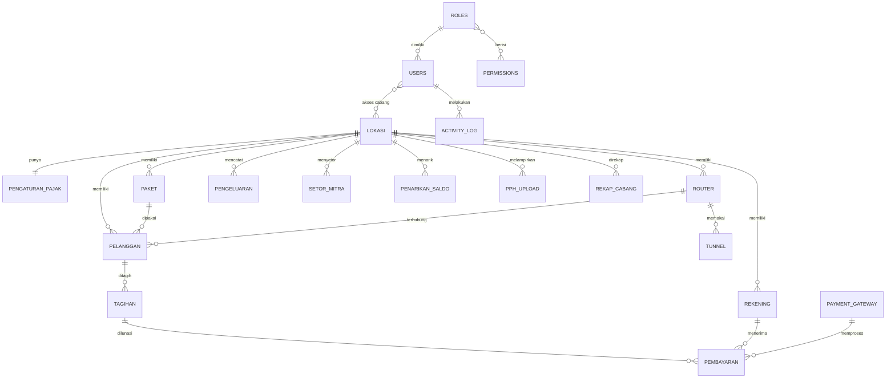

# Spesifikasi Rebuild — MSS Billing System · Role **Super Admin**

> Hasil analisa aplikasi lama (MSS e-Billing ISP), sudah dirampingkan sesuai menu Super Admin yang ditetapkan pemilik produk. Menu lain (Ticket, Voucher, HR, Inventaris, Corporate, WhatsApp Blast, Session MikroTik, dll.) **tidak dikerjakan** di tahap ini.
>
> **Tahap 1: UI/tampilan saja** dengan data dummy (mock). Struktur data di bawah dipakai untuk membuat mock data dan kontrak API. Backend dikerjakan di tahap berikutnya.
>
> Legenda: `*` wajib · `FK` relasi · `(derived)` nilai hasil hitung, tidak disimpan · `(asumsi)` perlu konfirmasi.

---

## 1. Konteks Singkat

- Aplikasi billing untuk ISP dengan banyak **Cabang/Lokasi** (dikelola mitra). Super Admin = pemilik ISP pusat yang memantau seluruh cabang.
- Pelanggan berlangganan **Paket** bulanan, membayar via **Cash, Transfer Bank, atau Payment Gateway** (Tripay, Xendit, Pakar Digital).
- Setiap cabang punya skema **bagi hasil & pajak** (PPN, Admin Fee, PPh, BHP, USO). Mitra cabang **menyetor kewajiban** ke pusat dan dapat **menarik saldo (WD)** pendapatannya.
- Format angka Indonesia: `Rp 1.250.000`, desimal koma. Tanggal: `27 Okt 2026`.

---

## 2. Struktur Menu (Sidebar)

```
1. Dashboard
2. Dashboard Cabang
3. Income Summary
4. Kelola Data
   ├─ Kartu Member
   ├─ Cabang / Lokasi
   ├─ Pengaturan Pajak
   ├─ Paket Pelanggan
   ├─ Router
   ├─ Rekening
   ├─ Notifikasi
   ├─ Upload Bukti PPh
   └─ Tunnel
5. Transaksi
   ├─ Penarikan Saldo Mitra
   ├─ Setor Kewajiban Mitra
   └─ Pengeluaran
6. Laporan
7. Payment Gateway
8. Logs
9. User
   ├─ Manajemen User
   └─ Hak Akses
```

Header: nama user, role, IP login, toggle dark/light, menu profil & logout.

---

## 3. Spesifikasi Halaman

### 3.1 Dashboard
Filter global (opsional): Cabang (Semua / per cabang).

**Kartu KPI** (klik → daftar pelanggan terkait):

| Kartu | Isi | Sumber |
|---|---|---|
| Data Pelanggan | Jumlah seluruh pelanggan (aktif + off) | `pelanggan` status ≠ berhenti |
| Pelanggan Sudah Lunas | Jumlah pelanggan lunas periode berjalan | `tagihan.status = lunas` bulan ini |
| Pelanggan Belum Lunas | Jumlah pelanggan belum lunas | `tagihan.status ≠ lunas` bulan ini |
| Pelanggan On | Jumlah pelanggan internet aktif | `status_langganan = on` |
| Pelanggan Off | Jumlah pelanggan diisolir/off | `status_langganan = off` |
| Pelanggan Berhenti | Jumlah pelanggan berhenti berlangganan | `status = berhenti` |
| Pemasukan Bulan Ini | Total nominal pembayaran bulan berjalan | Σ `pembayaran.jml_bayar` |
| Pemasukan Hari Ini | Total nominal pembayaran hari ini (asumsi: maksudnya hari ini) | Σ `pembayaran.jml_bayar` tgl = hari ini |

**Widget tambahan**

- **Pelanggan Baru Bulan Ini**: tabel ringkas (ID Pelanggan, Nama, Cabang, Paket, Tgl Registrasi) + tombol "Lihat Semua".
- **Data WAGW**: status perangkat WhatsApp Gateway (Terhubung/Terputus, nomor device, server), jumlah pesan terkirim, outbox, dan gagal hari ini. Read-only, dengan tombol "Kelola" (asumsi: kelola di halaman Notifikasi).
- (Opsional) Grafik pemasukan 12 bulan terakhir.

### 3.2 Dashboard Cabang
Filter: **Bulan + Tahun**, search, Export Excel. Tabel (horizontal scroll, kolom pertama sticky) + baris **Total** di bawah.

**Widget "Ringkasan Bulan Ini"** (di samping tabel, mengikuti aplikasi lama): dropdown pilih *Semua Cabang* (akumulasi) atau satu cabang; berisi Pemasukan Bulan Ini, DPP, PPN x %, Admin Fee x %, Bagi Hasil, Omset Reseller, PPh x %, Total Setor ke MSS, Pendapatan Reseller, Pemasukan Via Mitra, Sudah Setor ke MSS, Sudah WD ke Reseller, Pengeluaran, **Saldo / Balance**. Tombol 👁 untuk menyembunyikan nominal (diingat per browser) dan link **Selengkapnya** (→ Detail Cabang, atau Laporan bila Semua Cabang). Widget yang sama tampil di halaman Detail Cabang.

| # | Kolom | Rumus |
|---|---|---|
| 1 | Nama Cabang | `lokasi.nama_lokasi` |
| 2 | Jumlah Pelanggan | pelanggan aktif di cabang |
| 3 | Pelanggan Baru | registrasi di bulan terpilih |
| 4 | Pelanggan Free | pelanggan paket harga 0 |
| 5 | Pelanggan Lunas | tagihan periode berstatus lunas |
| 6 | Pelanggan Belum Lunas | tagihan periode ≠ lunas |
| 7 | Total Pemasukan | Σ `pembayaran.jml_bayar` cabang pada periode (sudah termasuk PPN) |
| 8 | Pemasukan Via Mitra | Pemasukan − Total Payment Gateway (uang cash/transfer yang dipegang mitra) |
| 9 | Total Cash | pemasukan metode cash |
| 10 | Total Payment Gateway | pemasukan via Tripay/Xendit/Pakar Digital (masuk ke rekening MSS) |
| 11 | DPP | Pemasukan ÷ (1 + %PPN) |
| 12 | PPN | Pemasukan − DPP |
| 13 | Admin Fee | persentase: DPP × %Admin Fee · nominal: Admin Fee × jumlah transaksi |
| 14 | Metode Bagi Hasil | Persentase (x %) / Nominal |
| 15 | Nominal Bagi Hasil | persentase: (DPP − Admin Fee) × % · nominal: nilai tetap per bulan (asumsi, lihat A2) |
| 16 | Omset Reseller | DPP − Admin Fee − Bagi Hasil |
| 17 | PPh | Omset Reseller × %PPh |
| 18 | Total Setor ke MSS | PPN + Admin Fee + Bagi Hasil + PPh (cabang pusat = 0) |
| 19 | Sudah Setor ke MSS | Σ `setor_mitra.nominal_setor` status diterima |
| 20 | Sisa Harus Setor | (18) − (19), minimal 0 |
| 21 | Pendapatan Reseller | Omset Reseller − PPh |
| 22 | Sudah WD ke Reseller | Σ `penarikan_saldo.nominal` status disetujui/dibayar |
| 23 | Sisa WD | (21) − (22), minimal 0 |
| 24 | Pengeluaran | Σ `pengeluaran.nominal` cabang pada periode |
| 25 | Saldo / Balance | (Total Payment Gateway + Sudah Setor) − (Total Setor ke MSS + Sudah WD). Negatif = mitra masih berutang ke MSS; positif = hak mitra yang masih ditahan MSS |

Contoh dari aplikasi lama (PPN 11 %, Admin Fee 5 %, PPh 2 %, bagi hasil nominal Rp 4.500.000, semua pemasukan via mitra): Pemasukan 9.050.000 → DPP 8.153.153 → PPN 896.847 → Admin Fee 407.658 → Omset Reseller 3.245.495 → PPh 64.910 → Total Setor ke MSS 5.869.414 → Pendapatan Reseller 3.180.586 → Saldo −5.869.414.

Aksi per baris: **Detail Cabang** (halaman detail: KPI cabang + Ringkasan Bulan Ini + daftar pelanggan + pembayaran + pengeluaran cabang).

### 3.3 Income Summary
Filter: **Bulan + Tahun** (default bulan berjalan).

- Kartu **Total Income Summary** (Σ semua metode).
- Kartu per **metode pembayaran**: Cash, Transfer Bank (dapat dipecah per rekening), Tripay, Xendit, Pakar Digital. Tiap kartu menampilkan nominal + jumlah transaksi.
- Klik kartu → halaman/drawer **Daftar Pelanggan yang membayar dengan metode tersebut**: No Invoice, ID Pelanggan, Nama, Cabang, Periode, Nominal, Waktu Bayar, Petugas/Channel. Ada search & export.
- (Opsional) Donut chart komposisi metode.

### 3.4 Kelola Data

Pola setiap submenu: **List** (tabel + search + filter cabang + paginasi + export) → **Form Tambah/Edit** (modal atau halaman) → **Hapus** (konfirmasi). Semua aksi tercatat di Logs.

| Submenu | Kolom tabel | Field form |
|---|---|---|
| **Kartu Member** | ID Pelanggan, Nama, Alamat, Tlp, Paket, Harga, Tgl Registrasi, Tgl Jatuh Tempo | Read-only dari data pelanggan. Aksi: **Preview & Cetak kartu** (satuan/massal, PDF, QR/barcode ID pelanggan) |
| **Cabang/Lokasi** | Kode, Nama, Alamat, Tlp, Tlp Owner, Metode Bagi Hasil, Bagi Hasil, Jumlah Pelanggan, Terima Cash, Status | Lihat §4.2 |
| **Pengaturan Pajak** | Cabang, PPN %, PPh %, BHP %, USO %, Admin Fee, Berlaku Sejak | Lihat §4.3 |
| **Paket Pelanggan** | Nama Paket, Keterangan, Harga, Jenis (Bulanan/Non-bulanan), Profile MikroTik, Cabang, Tampil di Registrasi, Jumlah Pelanggan | Lihat §4.4 |
| **Router** | ID, Nama Router, IP:Port API, Cabang, Jumlah Pelanggan, Status Koneksi | Lihat §4.5. Aksi: **Tes Koneksi** |
| **Rekening** | Nama Bank/E-wallet, Atas Nama, No Rekening (dimasking), Cabang, Tampil di Invoice | Lihat §4.6 |
| **Notifikasi** | Nama Notifikasi, Jadwal (H-x / tanggal), Jam, Tipe, Target, Tampilkan Link Bayar, Cabang, Status | Lihat §4.7. Aksi: Preview pesan |
| **Upload Bukti PPh** | Nama PPh, Cabang, Periode, Lampiran, Keterangan, Waktu Upload, Petugas | Lihat §4.8. Filter tahun |
| **Tunnel** | Nama Tunnel, User, Router/Cabang, Status | Lihat §4.9 |

### 3.5 Transaksi

| Submenu | Kolom tabel | Fitur |
|---|---|---|
| **Penarikan Saldo Mitra** | No, Nama Request, Mitra/Cabang, Periode Sumber, Nominal, Waktu Request, Status, Petugas | Tambah request, **Setujui/Tolak**, upload bukti transfer, filter status & bulan. Tampilkan saldo tersedia mitra saat input |
| **Setor Kewajiban Mitra** | No, Cabang/Mitra, Periode, Nominal Harus Setor, Nominal Disetor, Metode/Rekening, Bukti, Status, Waktu Entry | Tambah setoran, **Verifikasi**, cetak kuitansi, filter bulan / semua periode, export |
| **Pengeluaran** | Cabang, Jenis Pengeluaran, Tipe (Wajib Bulanan/Tidak), Waktu, Nominal, Metode (Cash/Rekening), Bukti, Keterangan, Dicatat Oleh | Filter bulan/tahun & cabang, footer ringkasan (Pemasukan, Pengeluaran, Balance), **Master Pengeluaran Wajib Bulanan** (template otomatis tiap bulan) |

### 3.6 Laporan
- Isi sama dengan **Dashboard Cabang** (§3.2) dalam bentuk laporan.
- Filter: **Bulanan** (bulan + tahun) atau **Tahunan** (tahun → kolom/total diakumulasi 12 bulan, atau tabel per bulan).
- Aksi: **Export Excel & PDF**, **Simpan Rekap** (snapshot bulan ditutup, lihat §4.13).

### 3.7 Payment Gateway
| Kolom | Field form |
|---|---|
| Provider, Mode, Cabang, Biaya Admin, Beban Biaya, Status | Lihat §4.10 |

Sub-halaman **Channel/Merchant**: daftar metode yang diaktifkan per provider (VA BCA, VA BRI, QRIS, dll.), dengan toggle aktif.

### 3.8 Logs (Riwayat Aktivitas)
Tabel read-only: Waktu, User, Role, Modul, Aksi (create/update/delete/login/logout/export/approve), Deskripsi, IP Address, User Agent. Filter rentang tanggal, user, modul, dan aksi. Klik baris → detail **perubahan data (sebelum → sesudah)**.

### 3.9 User
- **Manajemen User**: Nama, Username/Email, Tlp, Role, Cabang yang diakses, Status, Login Terakhir. Aksi: Tambah, Edit, Nonaktifkan, Reset Password.
- **Hak Akses**: daftar Role → editor **matriks permission** (baris = menu/submenu, kolom = Lihat / Tambah / Ubah / Hapus / Export / Approve). Role Super Admin terkunci (semua akses).
- **Kelola User** (profil sendiri): ubah profil, ganti password.

---

## 4. Struktur Data

### 4.1 Relasi


### 4.2 `lokasi` (Cabang)
| Field | Tipe | Ket |
|---|---|---|
| id | bigint PK | |
| kode_lokasi* | varchar(20) unique | contoh `C099` |
| nama_lokasi* | varchar | |
| alamat_lokasi* | text | |
| tlp_lokasi | varchar | |
| tlp_owner | varchar | |
| id_mitra | FK users | pemilik/mitra cabang |
| metode_bagi_hasil | enum(`persentase`,`nominal`) | |
| nilai_bagi_hasil | decimal(15,2) | |
| group_wa | varchar | ID grup WA notifikasi |
| terima_cash | boolean | |
| status* | enum(`aktif`,`tidak_aktif`) | |
| created_at, updated_at | timestamp | |

### 4.3 `pengaturan_pajak`
| Field | Tipe | Ket |
|---|---|---|
| id | PK | |
| id_lokasi | FK lokasi, null = default global | |
| ppn_persen | decimal(5,2) | |
| pph_persen | decimal(5,2) | PPh (dari Omset Reseller), contoh 2 % |
| bhp_persen | decimal(5,2) | |
| uso_persen | decimal(5,2) | |
| admin_fee_tipe | enum(`persentase`,`nominal`) | |
| admin_fee | decimal(15,2) | persentase dihitung dari DPP, contoh 5 % |
| berlaku_sejak | date | riwayat perubahan |

### 4.4 `paket`
| Field | Tipe | Ket |
|---|---|---|
| id | PK | |
| nama_paket* | varchar | contoh "Ultra 20 Mbps" |
| keterangan* | varchar | |
| harga* | decimal(15,2) | 0 = paket free |
| jenis* | enum(`bulanan`,`non_bulanan`) | |
| id_lokasi* | FK | |
| filter_lokasi | boolean | hanya untuk cabang tsb |
| tampil_registrasi | boolean | |
| id_router | FK nullable (null = semua router) | |
| jns_koneksi | enum(`pppoe`,`hotspot`) | |
| profile_mikrotik* | varchar | |
| buat_profile | boolean | otomatis buat di MikroTik |
| buat_pool | boolean | |
| nama_pool, local_address, remote_address | varchar | |

### 4.5 `router`
| Field | Tipe |
|---|---|
| id, kode_router | PK, varchar |
| nama_router* | varchar |
| host* | varchar (IP/domain) |
| port_api* | int (default 8728) |
| username* | varchar |
| password* | text terenkripsi (jangan dikirim ke frontend) |
| id_lokasi* | FK |
| status_koneksi | enum(`online`,`offline`) (derived / last check) |
| last_checked_at | timestamp |

### 4.6 `rekening`
| Field | Tipe |
|---|---|
| id | PK |
| nama_rekening* | varchar (BCA, BRI, BNI, DANA, …) |
| atas_nama* | varchar |
| no_rekening* | varchar |
| id_lokasi* | FK |
| tampil_invoice | boolean |
| is_cash | boolean (record khusus "Cash/Tunai") |

### 4.7 `notifikasi_template`
| Field | Tipe | Ket |
|---|---|---|
| id | PK | |
| nama_notifikasi* | varchar | contoh "Reminder H-3" |
| tipe* | enum(`reminder_tagihan`,`jatuh_tempo`,`isolir`,`bukti_bayar`,`pelanggan_baru`) | (asumsi) |
| jadwal_tipe | enum(`serentak_tanggal`,`relatif_jatuh_tempo`) | |
| tgl_kirim / offset_hari | int | tanggal tetap atau H-x / H+x |
| jam_kirim | time | |
| target | enum(`belum_lunas`,`semua`,`off`) | |
| tampilkan_link_bayar | boolean | |
| id_lokasi | FK nullable | null = semua cabang |
| isi_pesan* | text | mendukung placeholder `{nama}`, `{tagihan}`, `{jatuh_tempo}`, `{link}` |
| status | boolean | |

`wagw_device` (untuk widget Dashboard): id, nama_device, nomor, server_url, status (`connected`,`disconnected`), last_seen. Rekap pesan per hari: `sent`, `outbox`, `failed` (derived dari `wa_message`).

### 4.8 `pph_upload`
| Field | Tipe |
|---|---|
| id | PK |
| nama_pph* | varchar |
| id_lokasi* | FK |
| periode* | date (bulan) |
| lampiran* | file (PDF/JPG) |
| keterangan | text |
| uploaded_by | FK users |
| created_at | timestamp |

### 4.9 `tunnel`
id, nama_tunnel*, username, password (enkripsi), id_router (FK), status.

### 4.10 `payment_gateway` & `pg_channel`
| Field | Tipe | Ket |
|---|---|---|
| id | PK | |
| provider* | enum(`tripay`,`xendit`,`pakar_digital`,`moota`) | |
| mode* | enum(`join_ebilling`,`private`) | akun bersama vs akun sendiri |
| id_lokasi* | FK | |
| merchant_code, api_key, private_key, pin, email_api | text terenkripsi | |
| beban_biaya* | enum(`pelanggan`,`perusahaan`) | |
| biaya_admin | decimal | |
| status* | enum(`aktif`,`tidak_aktif`) | |

`pg_channel`: id, id_payment_gateway, kode_channel (BCAVA, QRIS, …), nama_channel, aktif (bool).

### 4.11 Data transaksi pendukung (sumber angka dashboard & laporan)

**`pelanggan`** (versi minimal untuk tahap ini)
| Field | Tipe |
|---|---|
| id, id_pelanggan | PK, varchar unique |
| nama*, alamat*, tlp*, email | |
| id_lokasi*, id_paket*, id_router | FK |
| tgl_registrasi* | date |
| tgl_jatuh_tempo | tinyint 1–31 |
| jns_tagihan | enum(`prabayar`,`pascabayar`) |
| status | enum(`aktif`,`berhenti`) |
| status_langganan | enum(`on`,`off`) |
| tgl_berhenti | date nullable |

**`tagihan`**: id, no_invoice, id_pelanggan, periode (YYYY-MM-01), nominal_paket, ppn, diskon, lain_lain, total, tgl_jatuh_tempo, status (`belum_lunas`,`lunas`,`sebagian`).

**`pembayaran`**
| Field | Tipe |
|---|---|
| id, no_invoice | |
| id_tagihan, id_pelanggan, id_lokasi | FK |
| jml_bayar* | decimal |
| metode* | enum(`cash`,`transfer`,`tripay`,`xendit`,`pakar_digital`) |
| id_rekening | FK (untuk transfer) |
| id_payment_gateway, reference_pg | FK, varchar |
| bukti_bayar | file |
| id_petugas | FK users |
| paid_at* | datetime |

### 4.12 Keuangan Mitra
**`penarikan_saldo`**
| Field | Tipe |
|---|---|
| id | PK |
| id_lokasi*, id_mitra* | FK |
| nama_request* | varchar |
| periode_sumber* | date (bulan pendapatan) |
| nominal* | decimal |
| keterangan* | text |
| status | enum(`pending`,`disetujui`,`ditolak`,`dibayar`) |
| bukti_transfer | file |
| diproses_oleh, diproses_at | FK users, datetime |

**`setor_mitra`**
| Field | Tipe |
|---|---|
| id | PK |
| id_lokasi* | FK |
| periode* | date (bulan) |
| nominal_harus_setor | decimal (snapshot dari rekap) |
| nominal_setor* | decimal |
| id_rekening* | FK (rekening pusat) / cash |
| bukti* | file |
| keterangan | text |
| status | enum(`menunggu_verifikasi`,`diterima`,`ditolak`) |
| diverifikasi_oleh | FK users |

**`pengeluaran`**
| Field | Tipe |
|---|---|
| id | PK |
| id_lokasi* | FK |
| tipe* | enum(`wajib_bulanan`,`tidak_wajib`) |
| jenis_pengeluaran* | varchar |
| keterangan | text |
| nominal* | decimal |
| id_rekening | FK (null = cash) |
| waktu* | datetime |
| bukti | file |
| is_template | boolean (master wajib bulanan) |
| created_by | FK users |

### 4.13 `rekap_cabang` (snapshot laporan)
id, id_lokasi, periode (bulan), lalu seluruh kolom §3.2 (jumlah_pelanggan, pelanggan_baru, pelanggan_free, lunas, belum_lunas, pemasukan, pemasukan_via_mitra, total_cash, total_pg, dpp, ppn_persen, ppn, admin_fee, metode_bagi_hasil, nominal_bagi_hasil, omset_reseller, pph_persen, pph, harus_setor, sudah_setor, sisa_setor, pendapatan_reseller, total_wd, sisa_wd, pengeluaran, saldo), closed_by, closed_at.

### 4.14 User & Hak Akses
| Tabel | Field |
|---|---|
| `users` | id, nama*, username* unique, email, tlp, password (hash), id_role*, status (`aktif`,`nonaktif`), last_login_at, last_login_ip, foto |
| `roles` | id, nama* (Super Admin, Admin, Mitra, Sales, Teknisi, …), keterangan, is_locked |
| `permissions` | id, menu_key (mis. `kelola_data.paket`), action (`view`,`create`,`update`,`delete`,`export`,`approve`) |
| `role_permission` | id_role, id_permission |
| `user_lokasi` | id_user, id_lokasi (batas akses cabang; Super Admin = semua) |

### 4.15 `activity_log`
| Field | Tipe |
|---|---|
| id | PK |
| id_user | FK |
| modul | varchar |
| aksi | enum(`login`,`logout`,`create`,`update`,`delete`,`export`,`approve`,`reject`) |
| subject_type, subject_id | varchar, bigint |
| deskripsi | varchar |
| data_lama, data_baru | json |
| ip_address, user_agent | varchar |
| created_at | timestamp |

---

## 5. Instruksi untuk Agent (Tahap UI)

1. **Stack UI** (sudah dikonfirmasi): Laravel 13 + Inertia.js v3 + React 19 (JavaScript/JSX) + template **Cuba** (Bootstrap 5 + reactstrap), react-feather, ApexCharts. Mock data dari PHP (`App\\Support\\MockData`) dikirim sebagai props Inertia.
2. Bangun **layout admin**: sidebar collapsible sesuai §2, breadcrumb, header, dark/light mode, responsif (minimal tablet & HP).
3. Buat **mock data** (factory/seeder JSON) sesuai §4: ±10 cabang, ±300 pelanggan, 12 bulan pembayaran, data pengeluaran, setoran, dan penarikan.
4. Komponen reusable: `StatCard`, `DataTable` (search, filter, sort, paginasi, export, column toggle, sticky first column), `FilterBar` (bulan/tahun/cabang), `FormModal`, `ConfirmDialog`, `FileUpload`, `StatusBadge`, `CurrencyInput` (format Rupiah).
5. Field rahasia (password router, API key payment gateway) ditampilkan sebagai input password, dan di tabel cukup ditampilkan `••••`.
6. Setiap halaman list punya **empty state**, **loading skeleton**, dan **error state**.
7. Format angka/tanggal mengikuti locale `id-ID`.

---

## 6. Catatan & Asumsi yang Perlu Dikonfirmasi

| # | Hal |
|---|---|
| A1 | "Pemasukan Hari Ini" diasumsikan = total pembayaran **hari ini** (di permintaan tertulis "bulan ini"). |
| A2 | ~~Rumus kolom Dashboard Cabang~~ **Terjawab** dari "Ringkasan Bulan Ini" aplikasi lama (lihat §3.2). Sisa asumsi: dasar Bagi Hasil persentase = DPP − Admin Fee; Admin Fee tipe nominal = per transaksi; Pengeluaran tidak mengurangi Saldo. |
| A3 | Definisi "Pelanggan Free" = paket harga 0 atau ditandai gratis? |
| A4 | "Pelanggan Berhenti" berbeda dari "Off": Off = diisolir sementara, Berhenti = putus langganan. Benar? |
| A5 | Pengaturan Pajak berlaku per cabang (dengan default global)? |
| A6 | Role selain Super Admin (Admin, Mitra, Sales, Teknisi) akan didokumentasikan terpisah? |
